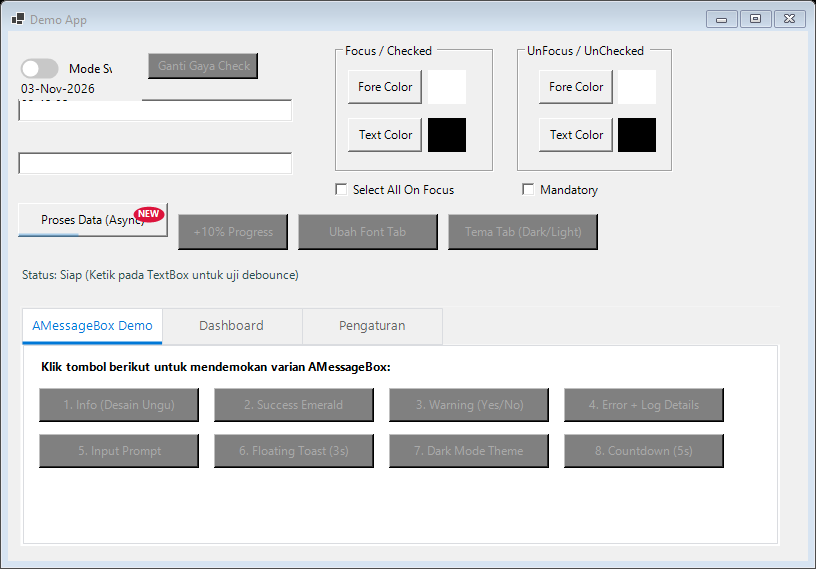
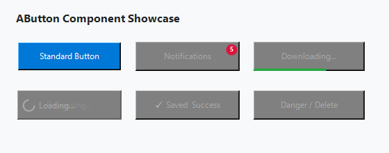
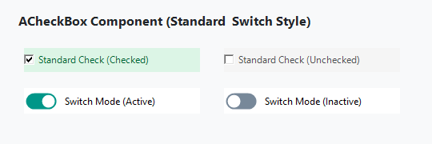
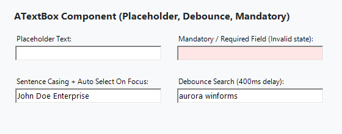
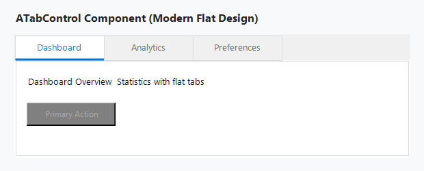
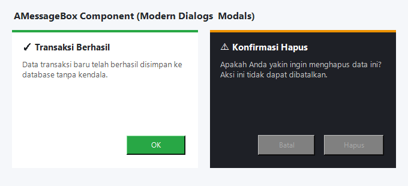
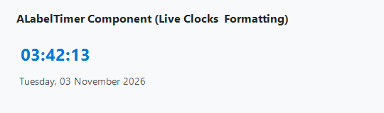

# AuroraControls

A modern, highly customizable UI component library for .NET WinForms. Designed to deliver clean, flat, and responsive visual enhancements to standard Windows Forms controls.



---

### Target Frameworks
* **.NET 8.0+** (`net8.0-windows`)
* **.NET Framework 4.7.2+** (`net472`)
* **.NET Framework 4.5** (`net45`)

---

### Components Showcase

#### 1. AButton
Enhanced button with async spinner loading, badge notification, progress bar overlay, and custom focus/hover palette.



* **Async Loading**: `IsLoading = true` renders a smooth spinner and locks user interactions.
* **Badge Notification**: `BadgeText` & `BadgeBackColor` for top-right notification badges.
* **Progress Bar**: `ProgressValue` (0-100) and `ProgressColor` for inline task feedback.
* **Custom Styling**: `FocusedColor`, `UnfocusedColor`, `FocusedTextColor`, `UnfocusedTextColor`.

---

#### 2. ACheckBox
Supports traditional checkbox and modern toggle switch styling.



* **Display Styles**: `Style = CheckBoxStyle.Standard` or `CheckBoxStyle.Switch`.
* **Switch Customization**: `SwitchOnColor`, `SwitchOffColor`.
* **Standard Customization**: `CheckColor`, `UnCheckColor`, `CheckTextColor`, `UnCheckTextColor`.

---

#### 3. ATextBox
Input field with cue banner placeholder, debounced search triggers, text casing, and validation indicators.



* **Cue Banner**: `PlaceholderText` for watermark/placeholder support.
* **Debounced Text Changed**: `DebounceDelay` (in ms) and `DebouncedTextChanged` event for real-time search without excessive queries.
* **Mandatory Validation**: `Mandatory = true`, `MandatoryColor`, and `IsValid` property.
* **Text Formatting**: `TextCasing` (`Normal`, `LowerCase`, `UpperCase`, `CapitalizeEachWord`, `SentenceCase`).
* **Focus Selection**: `SelectAllOnFocus = true` highlights text automatically on entry.

---

#### 4. ATabControl
Flat, borderless, container-aware tab control supporting custom header fonts and dark/light palettes.



* **Container Color Sync**: `ContainerColor` automatically propagates to child tab page backgrounds.
* **Header Customization**: `HeaderFont` and `ItemSize` for customized tab sizes.
* **Color States**: `ActiveTabColor`, `InactiveTabColor`, `HoverTabColor`, `IndicatorColor`, and `BorderColor`.

---

#### 5. AMessageBox
Modern card-style dialog replacing standard WinForms MessageBox.



* **Prebuilt Dialog Styles**: Info, Success, Warning, Error (with collapsible error logs/details).
* **Input Dialog**: `AMessageBox.ShowInput()` for quick prompt dialogs.
* **Floating Toast**: `AMessageBox.ShowToast()` for non-blocking notifications.
* **Theming & Countdown**: Supports Light/Dark themes and auto-close timers (`AutoCloseSeconds`).

---

#### 6. ALabelTimer
Live clock and interval timer label with real-time formatting.



* **Format Patterns**: `FormatText` (e.g. `HH:mm:ss`, `dddd, dd MMMM yyyy`).
* **Culture Support**: `Culture` property for localized date and time formats.
* **Interval**: Configurable update frequency.

---

### Getting Started

1. **Clone the repository:**
   ```bash
   git clone https://github.com/rgunawans/AuroraControls.git
   cd AuroraControls
   ```

2. **Build solution:**
   ```bash
   dotnet build src/AuroraControls.sln
   ```

3. **Run tests:**
   ```bash
   dotnet test src/AuroraControls.sln
   ```

4. **Run demo application:**
   ```bash
   dotnet run --project src/DemoProject/DemoProject.csproj -f net8.0-windows
   ```

5. **Generate NuGet package:**
   ```bash
   dotnet pack src/AuroraControls/AuroraControls.csproj -c Release
   ```

---

### Support
Support future development: https://paypal.me/rgunawans
